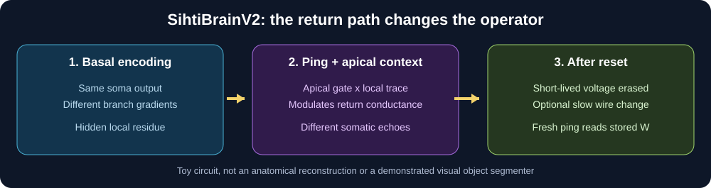

# SihtiBrainV2 — A dendrite keeps what the soma cannot see

**Basal evidence → branch-local cable gradients → somatic compression → state-shaped ping → delayed apical gate → response echo → optional persistent conductance write.**

SihtiBrainV2 tests a precise version of the Sihti Light intuition: a dendrite does not simply discard detail. Some distinctions remain locally in voltage gradients and can later be interrogated. A returning somatic event interacts with that local state and a delayed apical signal, possibly changing both what is visible and how the circuit responds in the future.

## Run

    python -m pip install -r requirements.txt
    python -m unittest discover -s tests -v
    python demo.py --output runs/first_echo

Outputs: `metrics.json` plus a six-panel `sihtibrain_v2.png`. CPU only. No ML frameworks required.

## Window 1: purify into distributed gradients

We use a seven-compartment reciprocal cable: soma 0; branch roots 1 and 4; leaves 2,3 under root 1 and 5,6 under root 4. Two equal-strength input configurations:

- **Cluster:** both currents at leaves 2 and 3.
- **Split:** currents at leaves 2 and 5.

For fixed cables, `H(W)=g_leak I+B diag(W) Bᵀ`. Passive voltage dynamics descend `E(v)=½vᵀH(W)v−Iᵀv`: `dv/dt=−∇_v E`. At equilibrium `v*=H(W)⁻¹I`.

Both inputs produce somatic voltage **1.565174859**. Their branch-root residues `r_i=v_root−v_soma` are different, however:

| | Cluster | Split |
|---|---:|---:|
| Soma | 1.565175 | 1.565175 |
| Left-root residue | 0.798201 | 0.146735 |
| Right-root residue | −0.504731 | 0.146735 |

This is *spatial observability*, not automatic lossless compression or image recognition.

## Window 2: probe the operator instead of repeating the read

The somatic pulse amplitude is a deterministic function of the soma's recent state. With exactly equal somatic histories, the sender emits exactly the same ping. This deliberately preserves the first experiment's blind spot.

Independent apical input `a=(a_left,a_right)` arrives with a delay. A local coincidence gate reads branch trace `r`:

    q_i = 1[ping>0] a_i sigmoid(8(r_i+0.25a_i−0.65))

During the returning event, the two soma-root conductances temporarily become

    W_fast,i = W_base,i (1 + 1.6 q_i)

The measured *echo* subtracts the same operator's no-ping baseline:

    echo(W) = [H(W)^(-1)(I+p e_soma)]_soma − [H(W)^(-1)I]_soma

Thus changes in the unpinged baseline are not mislabeled as probe information. Frozen linear cables cannot reveal the difference. A branch-state-dependent cable operator can.

A separate optional *slow* local write is

    W_slow,i ← W_base,i + η q_i max(r_i, 0)

This is an activity-dependent unsupervised write, **not** a supervised error gradient or evidence of perceptual learning. Erasing the old voltage and apical context, then injecting a fresh identical ping, reads the new stored conductance. The time-stepped `live_loop` makes the delayed gate causal (the pulse starts at the soma eight steps before the branch gate can arrive), while retaining the option to freeze the writer.

## Default demonstration: results in model units

| Gate | Observed |
|---|---:|
| Pre-ping soma difference | 0 |
| Fixed-operator ping-echo difference | less than 1e-14 |
| Contextual operator ping-echo difference | −0.11495 |
| Echo difference after erasing branch trace | less than 1e-14 |
| Post-reset read after idealized local write | −0.04817 |
| Post-reset read after delayed time-stepped write | −0.00897 |
| Time-stepped post-reset read, frozen writer | 0 |

There are 19 deterministic tests of mathematical invariants and negative controls. **These results establish what this constructed circuit does under its chosen parameters, not that biological cortical columns work this way.** The phenomenological gate is designed, not learned. It has not been benchmarked on unseen object categories, sequences, or real recordings.

The apical input can be supplied manually to isolate the mechanism or generated from **another column's previous-window voltages** by `context_from_neighbor`. Both compared inputs receive the **same** previous-neighbor context. The current soma does not somehow decode information it never observed.

## What this adds, and what it does not

Unlike [SihtiBrain](https://github.com/anttiluode/SihtiBrain), which studies passive cables, branch nonlinearities, supervised EqProp nudges and bistable kicks, V2 deliberately studies a **two-window unsupervised read/write loop**. It does not modify the first repo.

Neither the model nor the motivating analogy establishes that dendrites automatically perform object segmentation, that all of cortex performs global gradient descent, or that transformer residual addition equals energy minimization. Cortical Layer 1 input, Martinotti inhibition, and human L2/3 XOR-like responses are motivating biological features, not precise anatomical equivalents of these gates.

See [theory, caveats, and next experiments](docs/THEORY.md).